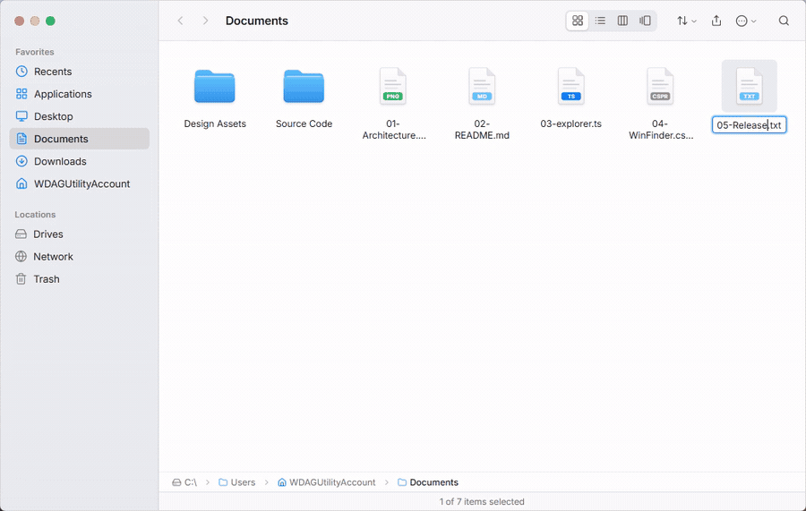

# WinFinder
A MacOS Finder inspired clone for Windows.



## Features

- **Finder-style views & tabs**: Icons, expandable List, Miller Columns, and Gallery views with multi-tab browsing (`Ctrl+T` / `Ctrl+click`)
- **Built-in file previews**: Gallery View previews images, videos, PDFs, HTML, Markdown, plain text, and syntax-highlighted source code
- **Very low memory footprint**
- **Fast search with Everything CLI**: optional Everything integration alongside Windows Search with full path results.
- **Native Windows integration**: Windows shell context menus (including Recycle Bin), inline rename (`F2`), and favorites.
- **Dark & Light themes**
- **No registry**: All configuration is stored in `~/.winfinder/config.json`.

## Install

### Windows (Scoop)

```sh
scoop bucket add winfinder https://github.com/yetanotherchris/WinFinder
scoop install winfinder
```

## Development

WinFinder is written using spec-driven-development and AI (Gemini 4 Neon), using Rust, Tauri and React.

```sh
npm install
npm run tauri dev
```
